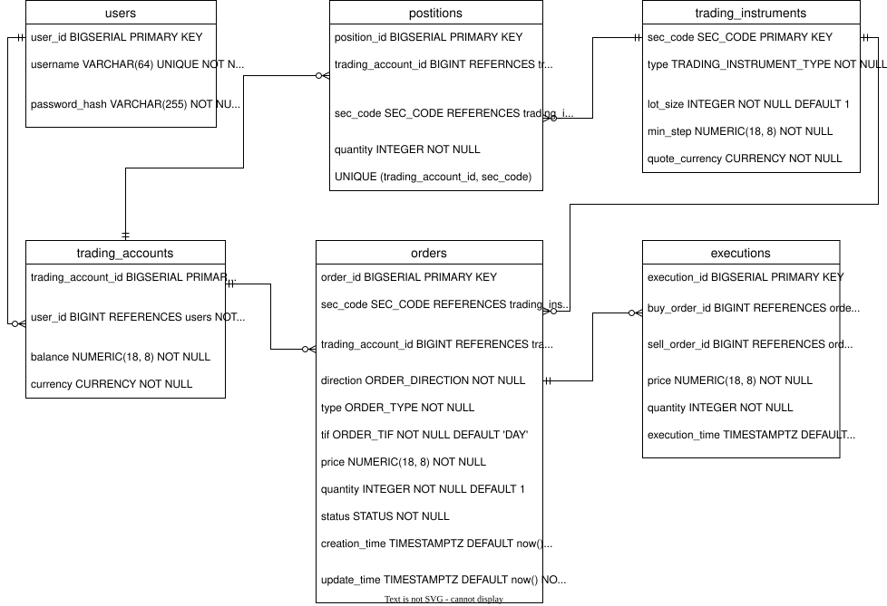
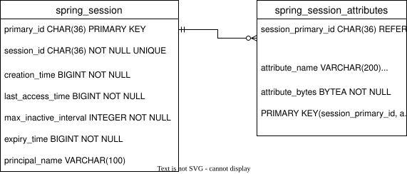

# Mini Exchange

REST API небольшой торговой системы по тестовому заданию.

## Стек
- Java 21
- Spring Boot 3.5
- Spring JDBC
- Spring Security
- Jakarta Validation
- PostgreSQL 18
- Liquibase
- Hurl
- Опционально доступен запуск с Docker Compose. 

## Документация

В директории `doc` находится автоматически сгенерированная [OpenAPI-спецификация](doc/openapi.json) с описанием эндпойнтов, параметров запросов и ответов.

## Модель данных

### Основные сущности



| Таблица               | Описание                                                                                                                         |
|-----------------------|----------------------------------------------------------------------------------------------------------------------------------|
| `users`               | Пользователь и данные входа. Хранится хеш пароля и имя пользователя.                                                             |
| `trading_instruments` | Код инструмента, его вид, размер лота, шаг цены и валюта котирования. Виды: `STOCK`, `BOND`, `CURRENCY_PAIR`.                    |
| `trading_accounts`    | Денежный баланс конкретного счёта. У пользователя может быть несколько счетов.                                                   |
| `positions`           | Количество инструмента на счёте. Пара "счёт -- инструмент" уникальна.                                                            |
| `orders`              | Заявка привязана к инструменту и счёту, направление `BUY`/`SELL` отделено от типа `LIMIT`. Основная доменная сущность приложения |
| `trades`              | Факт исполнения пары заявок по определённой цене. Инструмент и счета сторон определяются через связанные заявки.                 |


### Дополнения к предложенной в ТЗ модели данных

- Добавлены пользователи и позиции по инструментам.
- Покупка и продажа вынесены в `direction`, тип заявки -- в `type`.
- В заявке добавлены исходное и исполненное количество, срок действия и номер очереди. Остаток -- `quantity - filled_quantity`.
- `matching_pending` отмечает заявки, ожидающие обработки.
- Дополнительная таблица вне схемы `exchange_state` используется для общей блокировки торговых изменений.

Количество хранится в штуках, размер лота задаёт его кратность.

### Безопасность
Безопасность веб-приложения построена на модели сессий. Модель базы данных для реализации ограничений безопасности с помощью Spring Security и PostgreSQL взята из рекомендуемой в документации Spring.



Пароли хешируются с помощью Argon2. Заявки и реестры доступны владельцу, стакан общий для всех пользователей.

| Метод | Эндпойнт                | Назначение                      |
|-------|-------------------------|---------------------------------|
| GET   | `/api/v1/auth/csrf`     | Получить CSRF-токен.            |
| POST  | `/api/v1/auth/register` | Зарегистрировать пользователя.  |
| POST  | `/api/v1/auth/login`    | Войти в аккаунт.                |
| GET   | `/api/v1/auth/me`       | Получить текущего пользователя. |
| POST  | `/api/v1/auth/logout`   | Выйти из аккаунта.              |

Порядок работы:

1. Клиент получает CSRF-токен через `/api/v1/auth/csrf` и сохраняет cookie сессии.
2. При регистрации пароль хешируется внутри `UserService` с помощью `PasswordEncoder` и сохраняет пользователя.
3. При входе клиент передаёт логин, пароль, cookie и заголовок `X-CSRF-TOKEN`.
4. `AuthenticationManager` проверяет данные. `DatabaseUserDetailsService` загружает пользователя из БД, пароль проверяется через Argon2.
5. После входа меняется идентификатор сессии, контекст безопасности сохраняется в сессии. Клиент повторно получает CSRF-токен.
6. В следующих запросах Spring Session восстанавливает сессию по cookie `SESSION`, а Spring Security -- текущего пользователя. Для изменяющих запросов проверяется CSRF-токен.
7. Контроллер получает пользователя через `@AuthenticationPrincipal`.

## Бизнес-логика

### 1. Выставление заявок

Пользователь выбирает инструмент, счёт, направление, цену и количество. Система проверяет владельца счёта, валюту, шаг цены и кратность количества лоту.

Корректная заявка поступает в очередь исполнения. Поддерживаются лимитные заявки со сроком действия `DAY`. Деньги и инструменты проверяются перед сделкой, резервирования нет.

Эндпойнт: `POST /api/v1/orders`.

Проверка:

```shell
docker compose --profile tests run --rm hurl 1
```

### 2. Редактирование и отмена

Пользователь может изменить или отменить неисполненный остаток своей активной заявки.

Изменение цены или увеличение количества сбрасывает временной приоритет. Уменьшение количества при прежней цене сохраняет его. Новое количество задаётся вместе с уже исполненной частью.

При отмене остаток исключается из исполнения. Ранее заключённые сделки сохраняются.

Эндпойнты:

- `PUT /api/v1/orders/{id}` -- изменить заявку.
- `PATCH /api/v1/orders/{id}` -- отменить остаток.

Проверка:

```shell
docker compose --profile tests run --rm hurl 2
```

### 3. Исполнение заявок

Заявки исполняются по Price-Time Priority:

1. Для покупки выбирается самая дешёвая подходящая продажа, для продажи -- самая дорогая покупка.
2. При одинаковой цене первой исполняется раньше размещённая заявка.
3. Сделка проходит по цене ранее размещённой встречной заявки.
4. Количество сделки равно меньшему из двух остатков. Неисполненная часть продолжает участвовать в очереди.

При сделке покупатель получает инструменты и отдаёт деньги, продавец -- наоборот.

DAY-заявки истекают в `00:00` по московскому времени, торги продолжаются.

Исполнение происходит автоматически. Результат доступен через `GET /api/v1/trades` и `GET /api/v1/orders`.

Очередь исполнения хранится в PostgreSQL. Ожидающие обработки заявки отмечаются `matching_pending`, порядок поступления определяется через `queue_sequence`.

Фоновый `OrderScheduler` периодически вызывает `OrderService.matchNext()`. Каждый шаг выполняется в отдельной транзакции. Встречная заявка выбирается SQL-запросом с сортировкой по цене и номеру очереди. Если подходящей заявки нет, признак ожидания снимается и заявка остаётся в стакане.

Для согласования исполнения с созданием, редактированием и отменой используется общая блокировка строки `exchange_state` через `SELECT FOR UPDATE`. Перед расчётами дополнительно блокируются счета участников. Сделка, балансы, позиции и исполненное количество обеих заявок изменяются одной транзакцией.

После исполнения увеличивается `filled_quantity`. При нулевом остатке устанавливается статус `FILLED`, при частичном исполнении остаётся `NEW`.

Истечение DAY-заявок обрабатывается отдельным методом планировщика. Срок действия также проверяется непосредственно перед сделкой.

Проверка:

```shell
docker compose --profile tests run --rm hurl 3
```

### 4. Поток котировок

Стакан показывает размещённые активные заявки по инструменту. Заявки с одинаковой ценой объединяются отдельно для покупок и продаж. Уровень содержит цену, суммарный неисполненный остаток и количество заявок.

Покупки выводятся от дорогих к дешёвым, продажи -- от дешёвых к дорогим. `depth` ограничивает число уровней каждой стороны.

Дополнительно рассчитываются лучшая цена покупки (Best bid), лучшая цена продажи (best ask) и spread. Market Depth показывает сумму неисполненных остатков в возвращённых уровнях отдельно по каждой стороне.

Эндпойнт: `GET /api/v1/instruments/{secCode}/orderbook?depth=20`.

Проверка:

```shell
docker compose --profile tests run --rm hurl 4
```

### 5. Реестры заявок и сделок

Пользователь получает историю заявок своих счетов и сделок, в которых участвовал. Новые записи выводятся первыми.

Доступны фильтры по счёту, инструменту и периоду. Для заявок дополнительно предусмотрены статус и направление. Результат разбивается на страницы.

Эндпойнты:

- `GET /api/v1/orders` -- реестр заявок.
- `GET /api/v1/trades` -- реестр сделок.

Проверка:

```shell
docker compose --profile tests run --rm hurl 5
```

## Запуск проверок

Приложение должно быть запущено. Настройки подключения берутся из `.env`.

Перед первым запуском собрать образ:

```shell
docker compose --profile tests build hurl
```

Запустить все пять сценариев:

```shell
docker compose --profile tests run --rm hurl all
```

Каждый сценарий регистрирует своих пользователей, подготавливает данные и проверяет соответствующий пункт бизнес-логики.

## Запуск

Нужна Java 21. В корне создать `.env` и указать настройки подключения к БД:

```shell
cp example.env .env
```

### PostgreSQL через Docker Compose

```shell
docker compose -f compose.yaml up -d postgres
./gradlew bootRun --args='--spring.docker.compose.file=compose.yaml'
```

### Локальная БД

Создать БД и пользователя PostgreSQL, заполнить `.env`. Интеграция Compose отключается при запуске:

```shell
./gradlew bootRun --args='--spring.docker.compose.enabled=false'
```

Liquibase применяет миграции при старте. Базовый адрес API: `http://localhost:8080/api/v1`.